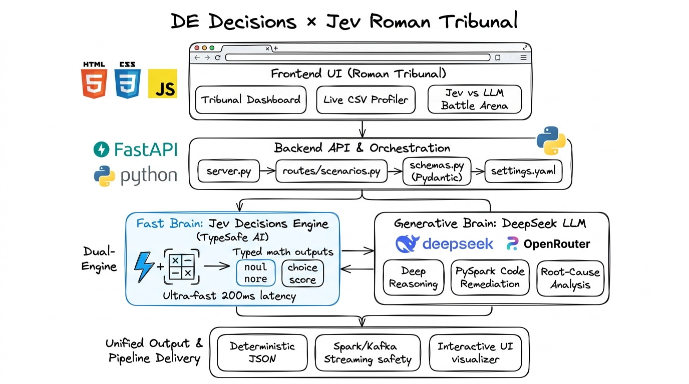

# 🏛️ DE Decisions × Jev Roman Tribunal
### *Production Data Engineering Decisions, Evaluated by TypeSafe AI & DeepSeek LLM*

[](https://www.python.org/)
[](https://fastapi.tiangolo.com)
[](https://openrouter.ai/)
[](https://openrouter.ai/)
[](https://deepseek.com)
[](LICENSE)

---

## 📌 Executive Overview & Core Problem Statement

Modern enterprise data architectures (Apache Spark, Kafka streaming clusters, Apache Airflow DAGs, Delta Lake, Snowflake, and Apache Iceberg) process petabytes of mission-critical information every single day. In these automated pipelines, systems must make split-second operational decisions:

- **Data Ingestion Gates**: Is incoming customer or financial data clean enough to write to bronze/silver lakehouse tables, or should corrupted partitions be quarantined immediately into a Dead-Letter Queue (DLQ)?
- **Dynamic Transformation Routing**: When processing large workloads, should the pipeline join, filter, aggregate, or cache next? Does the volume warrant an expensive distributed repartitioning?
- **Operational Anomaly Triage**: When a metric spikes or drops by 40%, is it expected seasonal variance (e.g., weekend shopping patterns) or a critical upstream failure that requires paging on-call platform engineers at 2 AM?
- **Lakehouse Storage Architecture**: What physical storage format (Delta Lake, Parquet, Iceberg) and indexing strategy minimizes cloud compute queries and prevents multi-thousand-dollar monthly cloud overbills?

### The Failure Modes of Legacy Approaches

Organizations have historically attempted to solve these operational decisions using two paradigms—both of which fail in production:

1. **Brittle Heuristic Rules (`if/else` hardcoding)**:
   - *The Problem*: Static thresholds cannot understand context. A 5% null rate on an optional `user_middle_name` column is completely harmless, whereas a 0.5% null rate on `transaction_id` or `stripe_payment_token` represents a critical revenue outage. Hardcoded rules either fire constant false alarms or miss silent data corruption.
2. **Standard Generative LLMs (ChatGPT / Claude / Standard Chat Models)**:
   - *The Problem*: Traditional conversational LLMs generate non-deterministic markdown strings and conversational prose. They suffer from high execution latency (**2,500 ms – 6,000 ms**), token cost overhead, and unpredictable formatting variance. Connecting a standard LLM to an automated Spark job or Kafka consumer risks pipeline crashes due to unexpected JSON keys, syntax hallucinations, and timeout bottlenecks.

### The Solution: Dual-Engine Architecture

This platform demonstrates the **Dual-Engine Architecture** for mission-critical data systems:
- ⚡ **The Fast Brain — Jev (TypeSafe AI)**: A System-1 structured decision engine operating at **~200 ms sub-second latency**. Rather than generating free-form text, Jev computes calibrated mathematical probabilities across strictly typed answer spaces (`noul` boolean probabilities, `choice` categorical distributions, `score` rubric levels). Outputs are 100% deterministic, machine-readable, and zero-risk for automated code branching.
- 💬 **The Generative Brain — DeepSeek LLM (via OpenRouter)**: A System-2 reasoning model providing deep root-cause analysis, architectural trade-off evaluations, and actionable PySpark/SQL remediation snippets for the engineering team.

---

## 🏛️ System Architecture

<p align="center">
  
</p>

### End-to-End Architectural Breakdown

```
┌─────────────────────────────────────────────────────────────────────────────┐
│ 1. EXPERIENCE LAYER (Roman Tribunal Web UI)                                 │
│    • Tribunal Dashboard: Interactive control plane for all 4 decision gates │
│    • Live CSV Profiler: Client-side exploratory data analysis & profiling   │
│    • Jev vs LLM Battle Arena: Real-time speed and determinism benchmark    │
│    • Pure HTML5/CSS3/Vanilla JS (No heavy build steps or npm node_modules)  │
└──────────────────────────────────────┬──────────────────────────────────────┘
                                       │ HTTP POST (Validated JSON Payload)
                                       ▼
┌─────────────────────────────────────────────────────────────────────────────┐
│ 2. BACKEND & ORCHESTRATION LAYER (FastAPI + Pydantic v2)                    │
│    • server.py: Application bootstrap, CORS, and static asset mount         │
│    • routes/scenarios.py: Context formulation, dispatching, and assembly    │
│    • schemas.py: Strict Pydantic models verifying request payload schemas   │
│    • config/settings.yaml: Runtime settings, model identifiers & parameters │
└───────────────────┬─────────────────────────────────────┬───────────────────┘
                    │                                     │
       [State + Questions]                           [Prompt Context]
                    ▼                                     ▼
┌──────────────────────────────────────┐  ┌───────────────────────────────────┐
│ 3A. FAST BRAIN (TypeSafe Jev)        │  │ 3B. GENERATIVE BRAIN (DeepSeek)   │
│ • services/jev_client.py             │  │ • services/mentor_chat.py         │
│ • Model: ~typesafe/jev-latest        │  │ • Model: deepseek-v4.1-flash      │
│ • OpenRouter Decisions API           │  │ • OpenRouter Chat Completions API │
│ • Latency: ~180ms – 300ms            │  │ • Latency: ~2,500ms – 4,500ms     │
│ • Outputs: noul, choice, score       │  │ • Outputs: Root-cause & Remediation│
└───────────────────┬──────────────────┘  └───────────────────┬───────────────┘
                    │                                         │
                    └────────────────────┬────────────────────┘
                                         │ Unified Result Assembly
                                         ▼
┌─────────────────────────────────────────────────────────────────────────────┐
│ 4. UNIFIED PIPELINE DELIVERY & CONSUMPTION                                  │
│    • Single unified JSON response with calibrated math and code suggestions │
│    • Deterministic pipeline execution (Kafka routing, Spark DAG branch)     │
│    • Interactive rendering with Roman gold & laurel visual indicators       │
└─────────────────────────────────────────────────────────────────────────────┘
```

---

## ⚡ Jev TypeSafe AI vs General LLMs

| Dimension | Standard Generative LLMs | Jev (TypeSafe AI) | Business & Engineering Impact |
|---|---|---|---|
| **Primary Output** | Free-form natural language markdown / prose | Strictly typed mathematical structures (`noul`, `choice`, `score`) | Jev responses integrate directly into code without parsing layers. |
| **Execution Latency** | 2,500 ms – 6,000 ms (High latency) | **180 ms – 350 ms (Sub-second)** | Jev can be deployed inside high-throughput streaming pipelines. |
| **Parsing Reliability** | Fragile regex / fuzzy string extraction required | **100% Deterministic native JSON** | Eliminates downstream pipeline crashes caused by unexpected markdown. |
| **Hallucination Risk** | Substantial (can invent invalid keys or values) | **Zero (strictly constrained to declared schema)** | High confidence in enterprise-grade production automation. |
| **Cost & Token Footprint** | Hundreds of input + output tokens per decision | Minimal prompt footprint, zero output token bloat | Up to **85% reduction in API token costs** at enterprise scale. |
| **Production Fit** | Offline human review, post-mortems, docs | **Spark streaming, Kafka event routing, Airflow gates** | Unlocks real-time AI automation where traditional LLMs are too slow. |

### Jev Typed Question Primitives

Jev evaluates questions formulated against a contextual `state` string using three typed mathematical primitives:

1. **`noul` (Calibrated Binary Probability)**:
   - Evaluates whether an operational condition is true or false.
   - Returns a continuous float between `0.0` (definitely false) and `1.0` (definitely true).
   - *Example*: `safe_to_use` $\rightarrow$ `0.94` (94% confidence that data is safe to pass downstream).
   - *Code Application*: `if response["safe_to_use"] < 0.40: trigger_quarantine_pipeline()`

2. **`choice` (Categorical Probability Distribution)**:
   - Evaluates the optimal alternative from candidates and provides the complete softmax distribution.
   - *Example*: `quality_issue` $\rightarrow$ `choice: "nulls"`, `probabilities: {"nulls": 0.82, "outliers": 0.12, "mixed_types": 0.06}`.
   - *Code Application*: Directly routes events to specialized cleaners based on the winning category.

3. **`score` (Continuous Rubric Level)**:
   - Evaluates severity, complexity, or priority along an ordered multi-tier rubric.
   - *Example*: `severity` $\rightarrow$ `2.6 / 3.0` (indicates high-medium severity requiring automated quarantine).
   - *Code Application*: Dynamic threshold alerting and operational severity escalation.

---

## 💼 Detailed Scenario Business Cases

Every scenario in the platform models a critical real-world operational bottleneck faced by modern data engineering and analytics platform teams.

---

### Scenario 1: Automated Data Quality Gate (`POST /api/data-quality`)

#### 🏢 Business Context & Problem Statement
In enterprise data ingestion architectures (e.g. streaming e-commerce orders, banking transactions, healthcare patient logs), data continuously flows from distributed third-party vendors, legacy ERPs, and mobile applications. Often, an upstream mobile app release or database migration introduces breaking changes: unexpected null spikes, corrupted strings, or extreme numerical outliers.

When corrupt data silently enters the Lakehouse (Silver/Gold layers), it poisons downstream business intelligence dashboards, invalidates executive financial reports, and triggers false retraining runs in machine learning models. Repairing corrupted data retroactively requires days of manual database surgery, backfilling, and audit recalculations.

#### ⚠️ Why Traditional Approaches Fail
- **Static Rules**: Writing `if null_ratio > 0.05` is brittle. A 5% null rate on `user_nickname` is perfectly acceptable, but a 0.5% null rate on `payment_transaction_id` represents an emergency revenue leakage. Rules lack the semantic context of what the column actually represents.
- **Traditional LLMs**: Running an LLM on every incoming batch takes 3–5 seconds per micro-batch, causing streaming backpressure in Kafka consumers and frequent parser crashes.

#### 💡 The Jev Solution
Jev assesses both the statistical profile (null percentage, distinct samples) and the semantic metadata (column name and business description) in **~200 ms**:
- `safe_to_use` (`noul`): Calibrated probability that the column is fit for downstream consumption.
- `quality_issue` (`choice`): Pinpoints the primary structural defect (`nulls`, `outliers`, `mixed_types`, `encoding`, `none`).
- `severity` (`score`): Evaluates operational risk on a 1.0 – 3.0 rubric.

#### 📈 Concrete Business Value & ROI
- **Zero Silent Ingestion Outages**: Corrupted batches are routed to a Dead-Letter Queue (DLQ) before corrupting core tables.
- **Automated Remediation**: DeepSeek automatically writes the remediation logic (e.g. PySpark `coalesce()` or IQR outlier clipping) so on-call engineers do not have to write boilerplate fixes from scratch.

---

### Scenario 2: Dynamic Pipeline Step Router (`POST /api/pipeline-router`)

#### 🏢 Business Context & Problem Statement
Modern multi-tenant data platforms process hundreds of heterogeneous workloads: 500M+ row transaction tables, 8M user profiles, and multi-gigabyte application telemetry streams. Traditional ETL/ELT pipelines execute static, predetermined sequences of transformations regardless of the physical characteristics of incoming data.

Executing an unoptimized sequence—such as joining two multi-gigabyte tables before filtering out invalid records, or performing distributed window aggregations without proper data partitioning—leads to massive memory spills, cluster Out-Of-Memory (OOM) executor failures, and skyrocketing cloud compute bills on Databricks, AWS EMR, or Snowflake.

#### ⚠️ Why Traditional Approaches Fail
- **Static DAGs**: Pipeline tools like Airflow or dbt execute rigid branches. They cannot inspect the intermediate state of an execution to dynamically insert a partitioning step or alter join orders without extensive manual DAG refactoring.
- **Traditional LLMs**: Incur excessive execution overhead and hallucinate nonexistent transformation function names.

#### 💡 The Jev Solution
Jev evaluates the input dataset size, the schema structure, the current intermediate output, and the analytical business objective:
- `next_step` (`choice`): Dynamically selects the mathematically optimal next operation (`join`, `aggregate`, `filter`, `normalize`, `enrich`, `cache`).
- `needs_partitioning` (`noul`): Evaluates whether current data volume and downstream query access patterns require distributed physical repartitioning (`repartition()` or `partitionBy()`).
- `complexity` (`score`): Predicts transformation complexity (1.0 = Simple Pandas/SQL, 2.0 = Window joins, 3.0 = Advanced distributed processing).

#### 📈 Concrete Business Value & ROI
- **Cloud Infrastructure Savings**: Eliminating unoptimized joins and unnecessary cluster shuffling cuts cloud compute bills by 25–40%.
- **SLA Reliability**: Dynamic step selection ensures batch and micro-batch jobs finish well within promised business delivery windows.

---

### Scenario 3: Operational Anomaly Triage (`POST /api/anomaly-triage`)

#### 🏢 Business Context & Problem Statement
On-call data engineers and platform reliability teams suffer from severe **Alert Fatigue**. In any modern enterprise monitoring hundreds of data tables, tools like Datadog, Monte Carlo, and Prometheus trigger dozens of alert notifications every week due to row count variances, ingestion delays, or metric shifts.

When engineers receive 50 alerts a week—45 of which are benign seasonal shifts (such as a 30% drop in B2B enterprise SaaS traffic over the weekend)—they naturally become desensitized. Eventually, a genuine catastrophic upstream ingestion failure is ignored, breaching customer SLAs and causing severe financial and reputational damage.

#### ⚠️ Why Traditional Approaches Fail
- **Static Thresholds**: Standard percentage thresholds (e.g. "alert if metric changes by >20%") fail because data volume naturally fluctuates depending on time-of-day, day-of-week, marketing promotions, and holidays.
- **Manual Investigation**: Every alert requires an engineer to manually query logs, compare historic baselines, and determine root cause, taking 30–60 minutes per incident.

#### 💡 The Jev Solution
Jev ingests the telemetry signal, comparing historical baselines against observed deviations in operational context:
- `is_real_anomaly` (`noul`): Delivers a calibrated probability distinguishing genuine operational failure from natural seasonal noise.
- `anomaly_type` (`choice`): Categorizes the exact pattern (`spike`, `drop`, `trend_shift`, `missing`, `duplicate`).
- `urgency` (`score`): Classifies operational urgency into three actionable tiers:
  - *Tier 1 (Monitor)*: Log event and monitor in the next execution cycle.
  - *Tier 2 (Investigate)*: Assign a support ticket for team review within the hour.
  - *Tier 3 (Page On-Call)*: Immediate automated escalation via PagerDuty/Opsgenie to protect business SLAs.

#### 📈 Concrete Business Value & ROI
- **70%+ Reduction in Alert Fatigue**: Benign seasonal shifts are suppressed automatically, allowing platform engineers to focus on real incidents.
- **Rapid Mean Time to Resolution (MTTR)**: Fast classification and DeepSeek's immediate 3-step investigation checklist reduce incident diagnosis time from 45 minutes to under 2 minutes.

---

### Scenario 4: Lakehouse Schema & Storage Advisor (`POST /api/schema-advisor`)

#### 🏢 Business Context & Problem Statement
Modern Data Lakehouse architectures (combining object storage like Amazon S3 or Google Cloud Storage with transactional table layers like Delta Lake, Apache Iceberg, or Apache Hudi) require critical upfront physical table design decisions:
- What storage format should be used? (Delta Lake for ACID and time travel? Apache Iceberg for multi-engine catalog evolution? Or lightweight Parquet?)
- Should Z-ordering or bloom-filter indexing be enabled on high-cardinality columns?
- To what degree should analytical tables be normalized versus denormalized?

An architectural miscalculation at table design time creates massive long-term technical debt. Using plain CSV or uncompressed Parquet for multi-terabyte query tables can result in $10,000+ per month in wasted Amazon Athena or Databricks query scanning costs, as well as multi-minute query latency for executive dashboards.

#### ⚠️ Why Traditional Approaches Fail
- **Trial-and-Error Architecture**: Teams often implement arbitrary table structures without systematically evaluating row cardinality and query patterns. Discovering poor performance six months later requires expensive full-table data migrations.
- **Conflicting Design Principles**: Balancing write performance (normalization, low write amplification) against read performance (denormalization, pre-joined wide tables) is difficult without standardized decision rubrics.

#### 💡 The Jev Solution
Jev analyzes table schemas, column count, estimated row volume, and data types to recommend an optimal storage architecture:
- `storage_format` (`choice`): Selects the optimal lakehouse storage format (`delta`, `iceberg`, `parquet`, `csv`, `json`).
- `needs_indexing` (`noul`): Probability assessment of whether Z-ordering or clustering keys are economically justified given table cardinality.
- `normalisation` (`score`): Recommends the optimal balance on a 1.0 (Denormalize for query speed) to 3.0 (Normalize to prevent write duplication) scale.

#### 📈 Concrete Business Value & ROI
- **Query Performance Optimization**: Z-ordering and proper columnar formats reduce query data scan volume by up to 90%, dramatically accelerating BI queries.
- **Architectural Consistency**: Standardizes Lakehouse design choices across all data engineering squads.

---

### Scenario 5: Jev vs LLM Battle Arena (`POST /api/compare-jev-vs-llm`)

#### 🏢 Business Context & Problem Statement
Enterprise engineering leadership is actively seeking ways to incorporate AI into operational pipelines, but many technical teams attempt naive implementations—such as passing pipeline events directly to OpenAI or Anthropic API endpoints using JSON prompt wrappers.

The Battle Arena exists to empirically prove why this approach is unsuitable for automated execution paths and to benchmark the exact speed, determinism, and safety differentials between the two AI paradigms.

#### 📊 Live Empirical Metrics
The Arena runs the identical data engineering scenario concurrently against both engines:
1. **Jev (TypeSafe AI)**:
   - *Latency*: **180 ms – 300 ms** (Sub-second execution)
   - *Output*: Native JSON object with mathematical floats and enumerated strings.
   - *Pipeline Safety*: **100% Safe**. Directly ingested into `if/else` control flow with zero string extraction or hallucination risk.
2. **Generative LLM (DeepSeek / GPT Models)**:
   - *Latency*: **2,500 ms – 5,000 ms** (10x – 25x slower)
   - *Output*: Paragraph prose and markdown code fences.
   - *Pipeline Safety*: **Unsafe**. Requires fragile regex parsing; syntax deviations crash streaming consumers.

#### 📈 Concrete Business Value & ROI
- Demonstrates tangible proof that **TypeSafe AI enables high-throughput automation** while generative models should remain in human-in-the-loop workflows.

---

### Interactive Live CSV Profiler & Data Lab

#### 🏢 Business Context & Problem Statement
Data engineering teams frequently receive ad-hoc, unvetted CSV datasets from external vendors, corporate acquisitions, and client uploads. Assessing whether a dataset is safe to merge into production pipelines traditionally requires writing manual exploratory analysis scripts in Jupyter Notebooks or pandas.

#### 💡 Built-in Client-Side Profiling
The web interface features an in-browser CSV parsing engine:
1. **Zero Data Egress Risk**: The raw CSV file is parsed directly in your local browser using the HTML5 `FileReader` API. Proprietary customer records and sensitive data never leave the local browser environment.
2. **Instant Profiling Metrics**: Automatically computes row count, null percentages, distinct value ratios, and sample value distributions for every column in seconds.
3. **One-Click Tribunal Evaluation**: Any profiled column can be sent directly into the Jev Decision Engine with a single click, providing immediate validation and remediation advice.

---

## 📂 Project Directory Structure

```
de-mentor-demo/
├── .env                          # Secret API keys (OPENROUTER_API_KEY) — gitignored
├── .env.example                  # Environment configuration template
├── .gitignore                    # Git rules (protects .env and .venv)
├── requirements.txt              # Python project dependencies
├── server.py                     # 🚀 Main entry point — FastAPI application & static mount
├── schemas.py                    # 📐 Pydantic request & response validation models
├── jev_questions.py              # ❓ Calibrated Jev question definitions (noul/choice/score)
│
├── config/
│   ├── __init__.py               # Configuration loader & constants exporter
│   └── settings.yaml             # 📋 Central YAML configuration (models, ports, presets)
│
├── docs/
│   ├── architecture.png          # 🖼️ Hand-drawn architecture diagram (White background)
│   ├── de-mentor-application-architecture.svg # Vector architecture schematic
│   └── de-mentor-application-architecture.png # Roman parchment themed architecture
│
├── routes/
│   ├── __init__.py               # Package marker
│   └── scenarios.py              # 🔀 API route handlers & Jev/DeepSeek orchestration
│
├── services/
│   ├── __init__.py               # Package marker
│   ├── jev_client.py             # ⚡ Jev Decisions API HTTP client (~200ms)
│   └── mentor_chat.py            # 💬 DeepSeek Generative Chat client via OpenRouter
│
└── static/
    └── index.html                # 🏛️ Roman Tribunal Single Page Application (HTML/CSS/JS)
```

### Codebase Architecture & Reading Order

| Step | File | Purpose |
|:---:|:---|:---|
| **1** | [`config/settings.yaml`](./config/settings.yaml) | Application configuration: models, OpenRouter endpoints, scenario presets |
| **2** | [`config/__init__.py`](./config/__init__.py) | Safe environment loading and YAML parsing into immutable constants |
| **3** | [`schemas.py`](./schemas.py) | Pydantic request models ensuring type safety before AI invocation |
| **4** | [`jev_questions.py`](./jev_questions.py) | Typed `noul`, `choice`, and `score` question suites for Jev |
| **5** | [`services/jev_client.py`](./services/jev_client.py) | Asynchronous communication with the Jev Decisions endpoint |
| **6** | [`services/mentor_chat.py`](./services/mentor_chat.py) | Generative LLM client for code suggestions and technical analysis |
| **7** | [`routes/scenarios.py`](./routes/scenarios.py) | Business logic combining structured decisions and generative AI |
| **8** | [`server.py`](./server.py) | FastAPI application bootstrapping, CORS, and static file serving |
| **9** | [`static/index.html`](./static/index.html) | Modern UI design, dynamic client profiling, and tribunal visualization |

---

## 🚀 Step-by-Step Setup Guide

### 1. Prerequisites
- **Python**: Version 3.10, 3.11, or 3.12 installed on your system.
- **OpenRouter API Key**: A valid key from [openrouter.ai](https://openrouter.ai/keys) with access to Jev and DeepSeek models.

### 2. Navigate to Project Directory
```bash
cd c:\Users\mihisara\Desktop\JEV\de-mentor-demo
```

### 3. Create and Activate Virtual Environment
On Windows (PowerShell):
```powershell
python -m venv .venv
.venv\Scripts\Activate.ps1
```

On macOS / Linux:
```bash
python3 -m venv .venv
source .venv/bin/activate
```

### 4. Install Dependencies
```bash
pip install -r requirements.txt
```

### 5. Configure Your API Key
Copy `.env.example` to `.env` and insert your OpenRouter API key:

On Windows (PowerShell):
```powershell
Copy-Item .env.example .env
```

On macOS / Linux:
```bash
cp .env.example .env
```

Then edit `.env` and set your key:
```ini
OPENROUTER_API_KEY=sk-or-v1-your-actual-openrouter-key-here
```

*(Note: Never commit your `.env` file to version control. It is already included in `.gitignore`.)*

### 6. Launch the Server
```bash
uvicorn server:app --reload --port 8001
```

### 7. Open the Application
- **Roman Tribunal Web UI**: [http://127.0.0.1:8001](http://127.0.0.1:8001)
- **Interactive OpenAPI Documentation (Swagger UI)**: [http://127.0.0.1:8001/docs](http://127.0.0.1:8001/docs)
- **Alternative ReDoc**: [http://127.0.0.1:8001/redoc](http://127.0.0.1:8001/redoc)

---

## 📡 API Reference & Specifications

### Summary of Endpoints

| Method | Endpoint | Description | Key Request Fields |
|---|---|---|---|
| `GET` | `/` | Serves the Roman Tribunal Single-Page Application | None |
| `GET` | `/health` | Healthcheck & API key validation | None |
| `POST` | `/api/data-quality` | Data Quality Gate (Jev + DeepSeek) | `column_name`, `null_pct`, `sample_values` |
| `POST` | `/api/pipeline-router` | Pipeline Step Router (Jev + DeepSeek) | `dataset_description`, `current_output`, `consumer_goal` |
| `POST` | `/api/anomaly-triage` | Operational Metric Anomaly Triage | `metric_name`, `baseline_value`, `observed_value` |
| `POST` | `/api/schema-advisor` | Lakehouse Table Architecture Advisor | `table_name`, `row_count_estimate`, `columns` |
| `POST` | `/api/compare-jev-vs-llm` | Side-by-side Jev vs LLM Speed & Safety Arena | `column_name`, `null_pct`, `sample_values` |
| `POST` | `/api/mentor-chat` | Technical analysis & code query endpoint | `question` |

### Sample Production Payload & Response

#### Quality Gate Evaluation (`POST /api/data-quality`)

**Request Payload:**
```json
{
  "column_name": "customer_email",
  "null_pct": 34.5,
  "sample_values": ["john@example.com", "null", "jane@corp.net", "null"],
  "description": "User email address captured during guest checkout"
}
```

**Response Payload:**
```json
{
  "scenario": "data_quality",
  "column": "customer_email",
  "jev": {
    "safe_to_use_prob": 0.28,
    "quality_issue": "nulls",
    "issue_probabilities": {
      "nulls": 0.86,
      "mixed_types": 0.08,
      "outliers": 0.04,
      "encoding": 0.02,
      "none": 0.00
    },
    "severity_score": 2.45
  },
  "mentor_tip": "With a 34.5% null rate, this column cannot serve as a reliable primary key. For downstream reporting, create a boolean flag `has_email` and coalesce missing values before joining.",
  "latency_ms": 224
}
```

---

## ⚙️ Configuration (`config/settings.yaml`)

All configurable behavior is declared in [`config/settings.yaml`](./config/settings.yaml). Key sections:

```yaml
server:
  port: 8001
  host: "127.0.0.1"
  reload: true

openrouter:
  api_key_env_var: "OPENROUTER_API_KEY"
  decisions_url: "https://openrouter.ai/api/alpha/decisions"
  chat_url: "https://openrouter.ai/api/v1/chat/completions"

models:
  jev_model: "~typesafe/jev-latest"
  chat_model: "deepseek/deepseek-v4.1-flash"
  chat_max_tokens: 512
```

---

## ❓ Frequently Asked Questions (FAQ)

<details>
<summary><b>1. Why not use standard JSON mode with ChatGPT or Claude?</b></summary>
While modern LLMs support JSON output mode, they still generate tokens sequentially (autoregressive generation), resulting in 2–5 seconds of latency per decision. Furthermore, they are prone to subtle schema deviations and empty outputs on edge cases. Jev evaluates calibrated probability spaces directly in ~200ms without text generation overhead.
</details>

<details>
<summary><b>2. How does the Live CSV Profiler protect data privacy?</b></summary>
The CSV file is parsed directly in your local browser using JavaScript FileReader. The raw file is never uploaded to the backend server. Only metadata and the first 10 sample values of selected columns are transmitted for AI evaluation.
</details>

<details>
<summary><b>3. What happens if the OpenRouter API key is invalid?</b></summary>
The `/health` endpoint detects missing or empty API keys. If an API request fails, the application returns informative HTTP error messages and highlights the setup step in the UI.
</details>

---

## 📜 License & Acknowledgments

This project is released under the **MIT License**.

- **Jev (TypeSafe AI)**: For pioneering typed machine-speed AI decisions.
- **DeepSeek**: For high-quality, efficient generative reasoning models.
- **OpenRouter**: For unified AI routing and API infrastructure.
- **FastAPI**: For state-of-the-art async Python web services.
